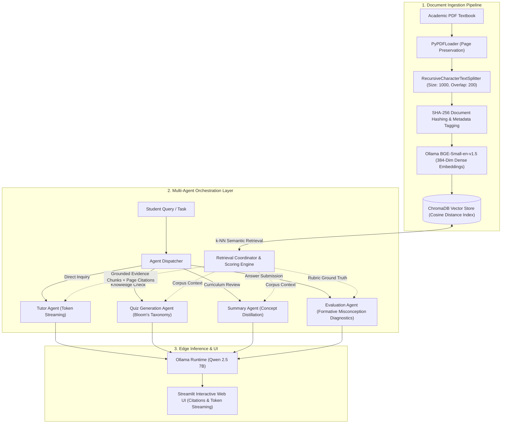

# EduGraph AI

**Local-First Multi-Agent Retrieval-Augmented Generation (RAG) & Educational Intelligence Engine**

*Sub-second dense semantic retrieval, deterministic citation grounding, offline LLM inference via Ollama (`qwen2.5:7b`), and automated pedagogical assessment orchestration across academic PDF corpora.*

[](https://www.python.org/)
[](https://python.langchain.com/)
[](https://www.trychroma.com/)
[](https://ollama.com/)
[](https://huggingface.co/BAAI/bge-small-en-v1.5)
[](https://streamlit.io/)
[](LICENSE)

---

## Technical Overview

**EduGraph AI** is an enterprise-grade, edge-deployable multi-agent RAG system engineered for rigorous academic inquiry, automated cognitive assessment, and curriculum distillation. By decoupling proprietary cloud APIs in favor of **100% air-gapped, zero-data-leakage local inference**, EduGraph AI enables institutions, researchers, and enterprises to query proprietary textbooks, technical manuals, and research corpora with strict mathematical guarantees against LLM hallucination.

Traditional consumer LLMs suffer from ungrounded extrapolation, losing source traceability when digesting 500+ page academic volumes. EduGraph AI solves this via a **4-tier agentic pipeline**:
1. **Deterministic Coordinate Ingestion:** PyPDF page-offset tracking preserving 1-to-1 page parity.
2. **Dense Metric Retrieval:** ChromaDB vector indexing powered by `BAAI/bge-small-en-v1.5` dense embeddings.
3. **Similarity Distance Calibration:** Bounded Cauchy-type score normalization preventing false-positive hallucination cascades.
4. **Agentic Pedagogical Consensus:** Specialized agents coordinating across tutoring, rubric-based grading, diagnostic misconception identification, and structured quiz synthesis.

---

## System Architecture



---

## Core Engineering Innovations

### 1. Bounded Distance Normalization & Anti-Hallucination Gate
Standard vector databases return raw distance metrics ($L_2$ Euclidean distance or cosine distance $d \in [0, 2]$), which non-technical architectures routinely pass straight into prompts without relevance validation. EduGraph AI implements a bounded Cauchy-type similarity transformation:

$$S(d) = \frac{1}{1.0 + \max(0.0, d)}$$

Where:
- $d$ represents the vector distance retrieved from ChromaDB.
- $S(d) \in (0, 1]$ represents normalized confidence.
- When $S(d) < \tau$ (configurable confidence threshold, default $\tau = 0.35$), the **Retrieval Coordinator** drops the context and triggers a **Hard Refusal Gate**. The LLM is mathematically prevented from inventing synthetic facts when ground truth evidence does not exist in the source document.

### 2. Multi-Agent Pedagogical Specialization
Rather than relying on a generic monolithic prompt, EduGraph AI segments tasks into deterministic functional agents:
- **`TutorAgent` (`agents/tutor_agent.py`):** Operates on token-level streaming (`langchain_ollama.OllamaLLM.stream`). Formulates answers strictly restricted to context chunks, appending explicit bracketed citations `[filename.pdf, page X]`.
- **`QuizAgent` (`agents/quiz_agent.py`):** Automatically produces structured multiple-choice questions (MCQs), true/false items, and open-ended technical challenges mapped directly to learning objectives extracted from the vector store.
- **`SummaryAgent` (`agents/summary_agent.py`):** Ingests macro corpus chunks to synthesize executive chapter recaps, key formula derivations, and conceptual study guides.
- **`EvaluationAgent` (`agents/evaluation_agent.py`):** Analyzes submitted student answers against textbook ground truth. Outputs a 3-part diagnostic: factual correctness score, verified textbook citations, and root-cause identification of cognitive misconceptions.

### 3. Local-First Air-Gapped Privacy
Every layer of the tech stack—from document parsing and vector indexing to neural inference—executes entirely within the local host memory space:
- **Zero API Egress:** No sensitive educational curricula, proprietary enterprise blueprints, or unreleased research drafts leave the local machine.
- **Deterministic Latency:** Eliminates network jitter, rate limits, and third-party API outage vulnerabilities.
- **Compute Optimization:** Quantized `qwen2.5:7b` runs efficiently on standard Apple Silicon (M1/M2/M3) unified memory or consumer NVIDIA RTX GPUs.

---

## Technical Specifications & Architecture Decisions

| Architectural Component | Production Choice | Considered Alternative | Engineering Trade-off & Rationale |
| :--- | :--- | :--- | :--- |
| **Inference Engine** | **Ollama (`qwen2.5:7b`)** | OpenAI GPT-4o / Claude 3.5 | Guarantees 100% offline data sovereignty; eliminates per-token API costs; operates with zero data egress. |
| **Embedding Model** | **`BAAI/bge-small-en-v1.5`** | `text-embedding-ada-002` | 384-dimensional dense vectors provide state-of-the-art MTEB retrieval performance at a fraction of memory overhead. |
| **Vector Store** | **ChromaDB (Local Persistent)** | Pinecone / Milvus / Weaviate | Embedded SQLite/Parquet backend eliminates cloud dependencies, network latency, and infrastructure provisioning. |
| **Document Parser** | **PyPDFLoader with Page Tagging** | Unstructured / OCR APIs | Preserves deterministic 1-to-1 page numbers for strict citation compliance; sub-millisecond per-page ingestion. |
| **Text Chunking** | **RecursiveCharacter (1000/200)** | Fixed Token Splitting | 1000-char window with 200-char overlap preserves semantic paragraph coherence without splitting technical formulas. |
| **Interface** | **Streamlit with Native Streaming** | React + FastAPI REST | Eliminates cross-origin state synchronization overhead; natively streams tokens directly from the Ollama generator iterator. |

---

## Directory Structure & Codebase Organization

```text
pdf-ai-ml-bot/
├── agents/                       # Specialized Multi-Agent Intelligence Core
│   ├── __init__.py
│   ├── retrieval_agent.py        # Dense similarity search & citation formatting
│   ├── tutor_agent.py            # Streamed question answering with anti-hallucination gating
│   ├── quiz_agent.py             # Automated assessment & rubric generation
│   ├── summary_agent.py          # Macro-document condensation & key concept distillation
│   └── evaluation_agent.py       # Student answer grading & misconception diagnosis
├── rag/                          # Retrieval-Augmented Generation Subsystem
│   ├── __init__.py
│   ├── ingest.py                 # PDF ingestion, chunk splitting, and metadata enrichment
│   └── vector_store.py           # ChromaDB client & BGE embedding lifecycle manager
├── utils/
│   ├── __init__.py
│   └── prompts.py                # Pedagogically calibrated system prompts & templates
├── data/                         # Local persistence layer (ignored by Git)
│   ├── uploads/                  # Extracted and indexed PDF artifacts
│   └── chroma/                   # Persistent vector embeddings database
├── tests/                        # Automated unit & integration test suites
│   ├── __init__.py
│   └── test_rag.py               # Deterministic pipeline verification tests
├── app.py                        # Streamlit multi-tab user interface application
├── config.py                     # Environment-backed configuration & fallback dataclasses
├── pytest.ini                    # Pytest test discovery configuration
├── requirements.txt              # Pinned Python package dependencies
└── README.md                     # Technical architecture documentation
```

---

## Getting Started

### Prerequisites
- **Python:** `3.12+`
- **Ollama:** Installed and running locally ([ollama.com](https://ollama.com/))
- **Hardware:** Minimum 8 GB Unified Memory (macOS Apple Silicon) or 8 GB VRAM (Linux/Windows)

### 1. Environment Setup
```bash
# Clone the repository
git clone https://github.com/Aryanban/pdf-ai-ml-bot.git
cd pdf-ai-ml-bot

# Create and activate an isolated Python virtual environment
python3.12 -m venv .venv
source .venv/bin/activate  # On Windows: .venv\Scripts\activate

# Install required dependencies
pip install -r requirements.txt

# Configure environment variables
cp .env.example .env
```

### 2. Pull Edge AI Models via Ollama
Ensure the Ollama daemon is active, then pull the calibrated LLM and dense embedding weights:
```bash
# Pull Qwen 2.5 7B instruction-tuned LLM
ollama pull qwen2.5:7b

# Pull BGE Small dense embedding model
ollama pull qllama/bge-small-en-v1.5
```

### 3. Launch the Application
```bash
# Launch Streamlit with project-specific theme settings
STREAMLIT_CONFIG_DIR="$PWD/.streamlit" streamlit run app.py
```
Access the application dashboard at `http://localhost:8501`.

---

## Verification & Automated Testing

The automated test suite verifies PDF parsing integrity, chunk overlap math, and deterministic citation metadata generation without requiring a running Ollama GPU instance:

```bash
# Run pytest verification suite
pytest -v
```

---

## Engineering Roadmap

- [ ] **Hybrid Sparse-Dense Retrieval (BM25 + Splade):** Implement Reciprocal Rank Fusion (RRF) to index exact technical keywords and mathematical notation.
- [ ] **Context Compression & Reranking:** Integrate FlashRank / Cohere Rerank locally to prune context tokens prior to generation.
- [ ] **Multi-Turn Graph Memory:** Persist student learning curves across sessions via LangGraph stateful checkpoints.
- [ ] **Tesseract OCR Integration:** Enable scanned and rasterized academic document extraction.

---

## Author & Engineering Portfolio

Developed by **Aryan Bansal** as part of an advanced AI engineering portfolio demonstrating offline-first edge LLM architectures, multi-agent orchestration, and retrieval engineering.

- **GitHub:** [@Aryanban](https://github.com/Aryanban)
- **LinkedIn:** [Aryan Bansal](https://linkedin.com/in/aryan-bansal)

---

## License

This project is licensed under the MIT License — see the [LICENSE](LICENSE) file for details.
